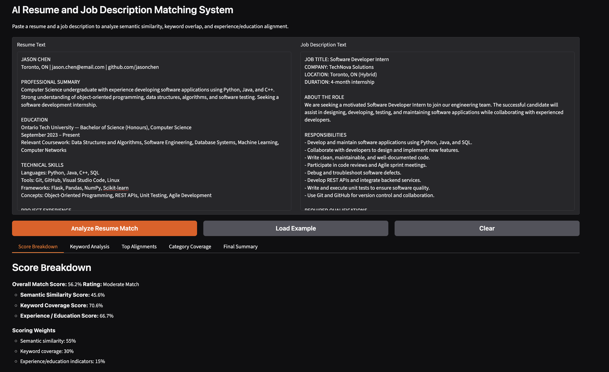
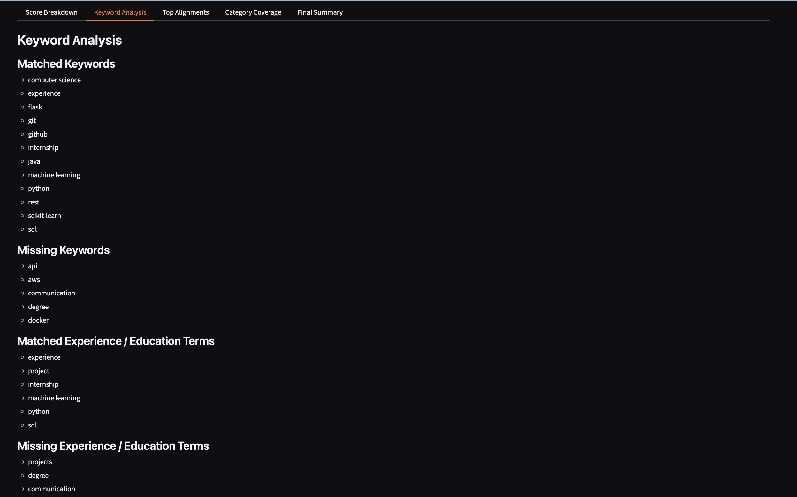
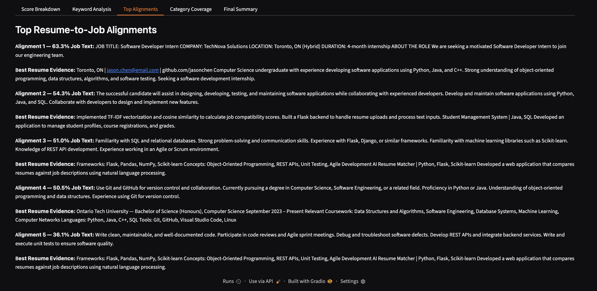
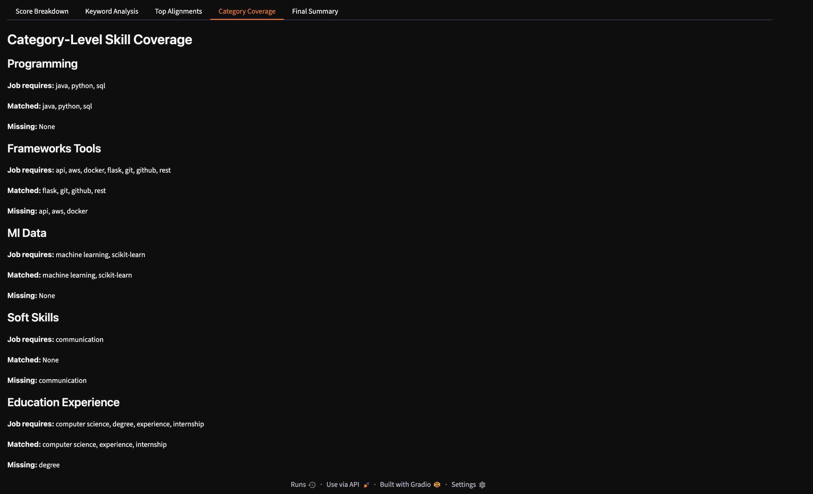
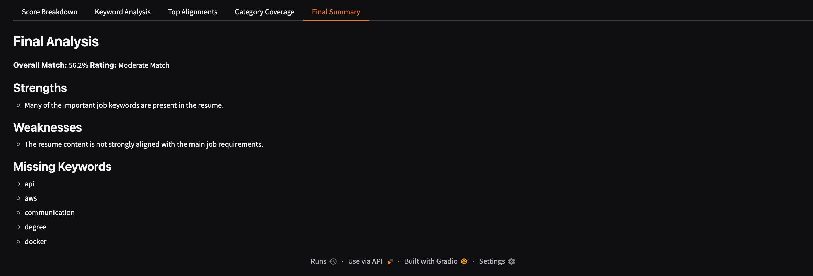

# AI Resume and Job Description Matching System

A machine-learning project that compares a resume with a job description and explains how closely they align. It uses sentence embeddings for **semantic similarity**, a predefined skills/keyword bank, and indicators of experience and education. The results appear in an interactive **Gradio** interface.

## Application preview

The five screenshots below show the application and its analysis screens.



<details>
<summary>View more screenshots</summary>

### Screenshot 2


### Screenshot 3


### Screenshot 4


### Screenshot 5


</details>

## Features

- **Resume and job description inputs:** Paste text into two side-by-side boxes.
- **Overall match score:** Combines three scoring components into a percentage and rating.
- **Semantic similarity:** Uses the pretrained `sentence-transformers/all-MiniLM-L6-v2` model to compare resume content with job requirements.
- **Keyword analysis:** Identifies matching and missing terms across programming, frameworks/tools, ML/data, soft skills, and education/experience categories.
- **Top alignments:** Shows the most relevant resume evidence for job-description passages.
- **Category coverage:** Summarizes matched and missing terms by category.
- **Final summary:** Reports strengths, weaknesses, and missing keywords.
- **Example and clear buttons:** Load sample inputs or reset the interface.

## How the score works

The application computes its overall percentage as follows:

| Component | Weight |
| --- | ---: |
| Semantic similarity | 55% |
| Keyword coverage | 30% |
| Experience and education indicators | 15% |

The score is a **project-specific matching heuristic**, not a hiring decision, official ATS score, or validated prediction of job performance. The keyword detection is based on a predefined vocabulary, so it will not capture every possible skill or variation in wording.

## Technology stack

- **Python** — core application and text processing
- **Gradio** — interactive web interface
- **Sentence Transformers** — pretrained sentence embedding model
- **PyTorch** — model backend
- **NumPy** — numerical operations
- **Jupyter Notebook** — original project notebook

## Run locally

Requirements: Python 3 and an internet connection for the initial pretrained-model download.

1. Clone the repository and go into the project directory:

   ```bash
   git clone https://github.com/kylekuopengliao/AI-Resume-Matcher-Machine-Learning-2-Final-Project-.git
   cd AI-Resume-Matcher-Machine-Learning-2-Final-Project-
   ```

2. Install dependencies (preferably in a virtual environment):

   ```bash
   python3 -m venv .venv
   source .venv/bin/activate
   python3 -m pip install -r requirements.txt
   ```

3. Launch the Gradio app:

   ```bash
   python3 app.py
   ```

4. Open the local URL printed in your terminal (typically `http://127.0.0.1:7860`).

**Notebook alternative:** Open `ML2_Final_Project.ipynb` in Jupyter or Google Colab, run the dependency-install cell, then run the application cell. The original notebook uses Gradio's temporary sharing option; public share links are not permanent.

## Using the application

1. Paste a resume into **Resume Text**.
2. Paste the target posting into **Job Description Text** (or select **Load Example**).
3. Click **Analyze Resume Match**.
4. Review the **Score Breakdown**, **Keyword Analysis**, **Top Alignments**, **Category Coverage**, and **Final Summary** tabs.

## Repository contents

```text
.
├── ML2_Final_Project.ipynb   # Original notebook
├── app.py                    # Standalone version of the notebook application
├── requirements.txt          # Python dependencies
├── screenshots/              # Five application screenshots
│   ├── screenshot1.png
│   ├── screenshot2.png
│   ├── screenshot3.png
│   ├── screenshot4.png
│   └── screenshot5.png
├── .gitignore
└── README.md
```

## Notes

- The pretrained embedding model downloads on first run, so initialization may take time.
- This version accepts **pasted text**, not direct PDF/DOCX resume uploads.
- Avoid entering confidential or sensitive personal information into shared or publicly hosted demos.
